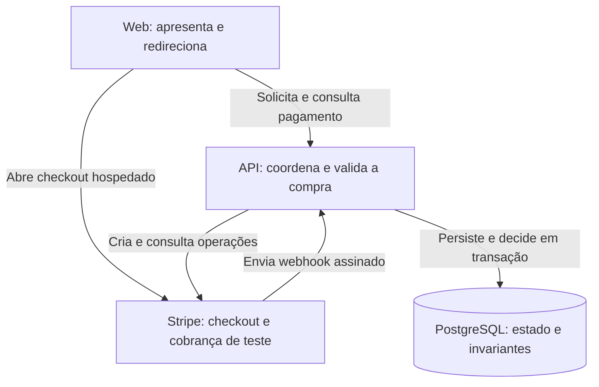
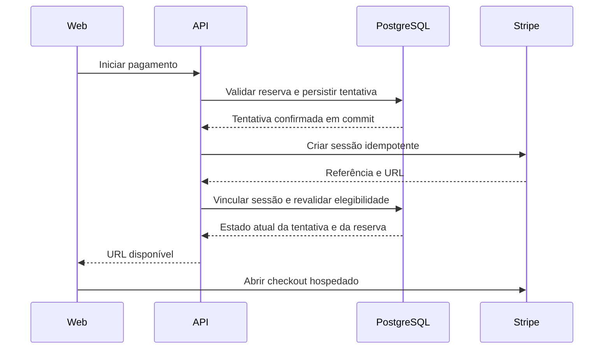
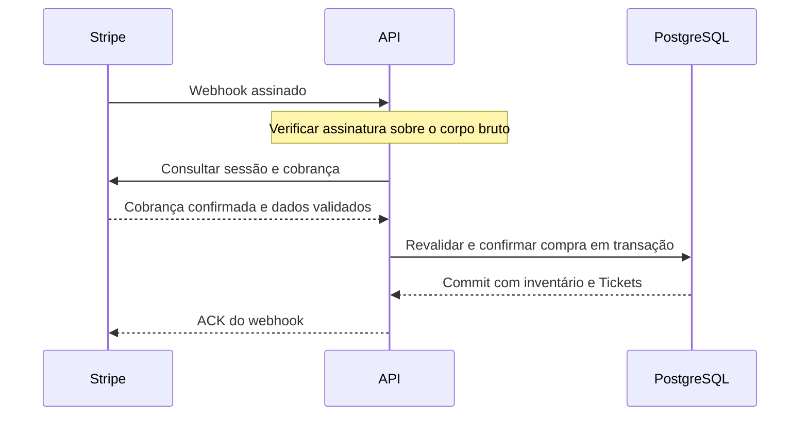
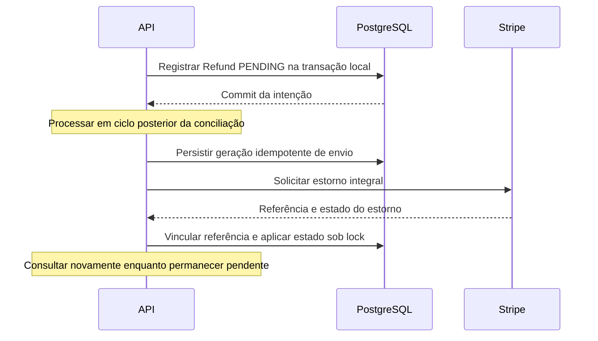

# Arquitetura do 9¾ Tickets

## Visão geral

O 9¾ Tickets é um monorepo com duas aplicações independentes:

```text
apps/
├── api/  # NestJS, TypeORM e PostgreSQL
└── web/  # React, Vite e TanStack Query
```

A API é um monólito modular. O frontend é organizado por features e consome a API por HTTP. O Docker Compose coordena as aplicações e o PostgreSQL no desenvolvimento local.

```text
Browser
  │
  ▼
React/Vite ──HTTP + cookie HttpOnly──▶ NestJS ──TypeORM──▶ PostgreSQL
                                         │
                                         └──▶ TMDb / Ticketmaster / Stripe sandbox
```

PostgreSQL é a autoridade dos invariantes transacionais. Estado do frontend, timers do navegador e atualizações em tempo real nunca substituem uma decisão persistida pelo backend.

## Organização do repositório

API e web possuem seus próprios:

- `package.json`;
- `package-lock.json`;
- dependências;
- scripts;
- configurações de TypeScript, lint e testes.

O root não possui package compartilhado nem scripts para executar as duas aplicações em conjunto. Essa coordenação pertence ao Docker Compose. Um package compartilhado só será criado se uma necessidade concreta justificar o acoplamento.

Consulte o [ADR 0002](adr/0002-dependencias-independentes-no-monorepo.md) para o contexto dessa decisão.

## API

### Estrutura atual

```text
apps/api/src/
├── config/              # leitura e validação centralizada do ambiente
├── database/            # DataSource, entidade base e migrations
├── errors/              # contrato comum de erros controlados
└── modules/
    ├── auth/            # login, sessão, cadastro, JWT e autorização
    ├── catalog/         # port de catálogo e adapters da TMDb e Ticketmaster
    ├── events/          # ocorrência, publicação e inventário seated materializado
    ├── payments/        # tentativa idempotente, checkout e conciliação
    ├── realtime/        # deltas de disponibilidade emitidos após commits
    ├── refunds/         # intenções de estorno e conciliação externa
    ├── reservations/    # holds temporários, itens, retomada e cancelamento
    ├── tickets/         # ingressos emitidos para ReservationItems confirmados
    ├── users/           # entidade User e enum de papéis
    └── venues/          # locais e layouts físicos reutilizáveis
```

Cada módulo de domínio deve manter próximos os seus contratos HTTP, entidades, regras e erros. Uma pasta de módulo não precisa conter controller, service ou repository próprios quando não existir comportamento que os justifique.

O acesso comum a dados utiliza diretamente `Repository<T>` do TypeORM. Classes de persistência específicas são reservadas a consultas semânticas, locking, escritas condicionais ou transações que acrescentem comportamento real.

### Colaboração entre módulos

Módulos internos podem colaborar diretamente quando a dependência é estável e clara. Interfaces e ports são priorizados nas fronteiras externas ou voláteis, como catálogos e pagamentos.

Não são adotados repository genérico, event bus interno, camada obrigatória de use cases ou interfaces que apenas renomeiem implementações concretas.

### Persistência

- TypeORM utiliza Data Mapper, sem Active Record.
- `synchronize` permanece desabilitado.
- Toda evolução de schema utiliza migration.
- Transações usam o `EntityManager` da própria transação.
- Restrições concorrentes pertencem prioritariamente ao PostgreSQL.

### Cancelamento e concorrência

Cancelamento de compra pelo CUSTOMER, cancelamento de Event pelo ORGANIZER e finalização de Payment disputam as mesmas entidades. Esses fluxos adquirem locks na mesma ordem e revalidam o estado autoritativo dentro da transação:

```text
Cancelamento CUSTOMER ──┐
Cancelamento ORGANIZER ─┼──▶ Event ──▶ Reservation(s por id) ──▶ Payment
Finalização de Payment ─┘                                      │
                                                               ▼
                                                    Ticket / EventSeat / Refund
                                                               │
                                                             commit
                                                               │
                                                               ▼
                                                        delta realtime
```

Quando existem várias Reservations no cancelamento de um Event, elas são bloqueadas por `id` em ordem crescente. A finalização de Payment pode fazer uma leitura inicial sem lock para descobrir as referências, mas somente decide depois de adquirir os locks e revalidar Event, Reservation e Payment.

O cancelamento de uma compra confirmada marca Reservation e Tickets como cancelados, devolve o inventário e cria Refund integral somente quando houve valor pago. O Payment permanece `APPROVED` como registro histórico. O cancelamento pelo ORGANIZER executa essas transições para as Reservations do Event e marca o próprio Event como `CANCELLED` no mesmo commit. Atualizações em tempo real são emitidas apenas depois do commit e não participam da decisão transacional.

### Pagamentos

A API seleciona o modo fake ou o checkout hospedado por configuração e informa o modo e os métodos ao Web por `GET /payments/configuration`. A escolha do provedor e suas credenciais ficam no backend. Os motivos da adoção do Stripe Checkout em sandbox estão na [ADR 0007](adr/0007-stripe-checkout-hospedado-no-sandbox.md); estados, limites e invariantes permanecem no [escopo técnico](application-scope.md#22-payment).

#### Visão geral

O Web apresenta a compra e abre o checkout hospedado. A Stripe processa a cobrança de teste. A API consulta o resultado externo e decide se a compra pode ser confirmada, usando o PostgreSQL como autoridade do estado local e das invariantes transacionais.



#### Responsabilidades no código

Cada participante dos diagramas representa uma aplicação ou serviço externo. A tabela detalha as responsabilidades internas da API. `HostedPaymentGateway` é o contrato utilizado pelos serviços; o adapter Stripe implementa esse contrato e executa o I/O externo.

| Componente                                                  | Responsabilidade                                                                                                       |
| ----------------------------------------------------------- | ---------------------------------------------------------------------------------------------------------------------- |
| `PaymentCheckoutConfigurationController`                    | Informa o modo e os métodos habilitados, sem expor credenciais.                                                        |
| `HostedCheckoutController` / `HostedCheckoutService`        | Protegem o acesso HTTP e coordenam criação, consulta e retomada da sessão hospedada.                                   |
| `PaymentsService`                                           | Persiste ou recupera a tentativa idempotente, calcula o total pelos itens e encaminha os fluxos fake e gratuitos.      |
| `PaymentRepository`                                         | Encapsula consultas com propriedade, vínculo externo condicional e operações de inventário.                            |
| `HostedPaymentGateway` / `StripeHostedPaymentGateway`       | Definem a fronteira externa e traduzem sessões, cobranças, expiração e estornos para contratos locais.                 |
| `StripeCheckoutWebhookController` / `StripeCheckoutWebhook` | Recebem o corpo bruto, verificam a assinatura e extraem a identidade da sessão a consultar.                            |
| `HostedPaymentReconciliationService`                        | Consulta o provedor por webhook ou varredura periódica, encaminha a finalização e solicita expiração quando aplicável. |
| `PaymentFinalizationService`                                | Revalida a observação sob locks e confirma a compra ou registra falha e intenção de estorno.                           |
| `HostedRefundReconciliationService`                         | Executa e acompanha as intenções de estorno persistidas, recuperando respostas perdidas.                               |
| `TicketsService` / `SeatRealtimeGateway`                    | Emitem Tickets na transação de confirmação e publicam deltas de assentos depois do commit, respectivamente.            |

O `PaymentsModule` conecta os adapters e registra os serviços de conciliação. No modo fake, `PaymentsController` chama `PaymentsService`: cartão passa pelo `FakePaymentGateway`, enquanto Pix usa a simulação local. Ambos convergem em `PaymentFinalizationService`.

#### Fluxos principais

As sequências mostram o caminho principal de uma compra paga no sandbox. Retomadas, falhas e compras gratuitas estão na tabela de exceções abaixo.

**1. Abrir o checkout**



A criação é coordenada por `HostedCheckoutService`, com persistência da tentativa por `PaymentsService`. A chamada à Stripe ocorre depois do commit local.

**2. Confirmar a compra**



O webhook encaminha a operação a `HostedPaymentReconciliationService`, que consulta o provedor e chama `PaymentFinalizationService`. A varredura periódica também executa essa conciliação. O Web consulta o estado pela API independentemente da entrega do webhook ou do ACK.

**3. Executar o estorno**



A intenção nasce no cancelamento elegível ou na finalização de uma cobrança sem compra válida. `HostedRefundReconciliationService` executa e acompanha a devolução. O estado local só chega a `COMPLETED` depois da confirmação externa.

#### Recuperação e exceções

| Situação                                              | Tratamento                                                                                                                                                                                  | Responsável                       |
| ----------------------------------------------------- | ------------------------------------------------------------------------------------------------------------------------------------------------------------------------------------------- | --------------------------------- |
| Reload ou retorno da Stripe                           | Consultar a tentativa persistida; o GET apresenta o estado sem criar sessão ou confirmar compra.                                                                                            | Checkout                          |
| Retomada com sessão vinculada                         | Consultar e validar a mesma sessão antes de devolver uma URL atualizada.                                                                                                                    | Checkout e adapter                |
| Timeout de criação sem referência local               | Buscar a sessão pela identidade da tentativa. Repetir a criação somente dentro da janela segura, com a chave e os parâmetros originais. Uma tentativa inconclusiva bloqueia outra cobrança. | Checkout e adapter                |
| Tentativa legada sem URL de retorno original          | Permitir descoberta da sessão, preservando a restrição à recriação sem os parâmetros históricos.                                                                                            | Checkout                          |
| Webhook perdido, repetido ou fora de ordem            | Consultar o estado atual no provedor e aplicar a observação pela mesma finalização transacional. A varredura periódica recupera callbacks perdidos.                                         | Conciliação de pagamentos         |
| Assinatura inválida ou divergência nos dados externos | Rejeitar a assinatura ou a observação divergente, impedindo a confirmação.                                                                                                                  | Validação de entrada e resultado  |
| Reserva inelegível com sessão ainda aberta            | Solicitar expiração fora da transação e consultar novamente o resultado, inclusive se houver cobrança concorrente.                                                                          | Conciliação de pagamentos         |
| Cobrança aprovada sem reserva ou inventário válidos   | Registrar a falha local e a intenção de estorno integral, preservando a evidência da cobrança e sem emitir Tickets.                                                                         | Finalização da compra             |
| Prazo vence durante as escritas de confirmação        | Reverter a compra; registrar falha e eventual estorno em outra transação.                                                                                                                   | Finalização da compra             |
| Resposta de estorno perdida                           | Consultar a referência conhecida ou buscar a intenção externa; um novo envio obedece à geração persistida e à janela idempotente.                                                           | Conciliação de estornos           |
| Compra gratuita ou modo fake                          | Usar a finalização local. Compras gratuitas dispensam sessão externa e Refund.                                                                                                              | Fluxo local                       |
| Cancelamento elegível de compra paga                  | Liberar inventário, cancelar Tickets e registrar a intenção de estorno na transação local. O modo fake conclui o Refund no próprio cancelamento.                                            | Cancelamento de reserva ou evento |
| API reiniciada ou Render Free hibernando              | Retomar a conciliação do estado persistido quando a API voltar. Os prazos locais continuam determinados pelo banco.                                                                         | Serviços de conciliação           |

#### Garantias transacionais

- O PostgreSQL fornece o relógio para decisões de validade. Timers da API e do navegador apenas agendam processamento ou apresentação.
- A confirmação e os cancelamentos seguem a ordem de locks `Event → Reservation → Payment`. A confirmação revalida prazo e inventário e verifica novamente o prazo após as escritas.
- Reserva, inventário e Tickets são confirmados na mesma transação. Constraints e revalidação sob lock protegem contra concorrência e repetição.
- Chamadas à Stripe acontecem fora das transações de compra, cancelamento e aplicação do resultado do estorno.
- A tentativa persiste antes da criação externa; a intenção de estorno persiste antes de seu envio. Chaves idempotentes e referências permitem recuperar operações sem depender da aba aberta.
- Deltas realtime são emitidos após o commit. O retorno do checkout e o polling apresentam o estado informado pela API.

Os procedimentos e as evidências de teste estão no [guia de validação do sandbox](stripe-sandbox-validation.md).

## Frontend

### Estrutura atual

```text
apps/web/src/
├── components/ui/       # componentes Shadcn mantidos como código local
├── config/              # configuração pública validada
├── features/
│   ├── auth/            # contratos, API, hooks e páginas de autenticação
│   ├── events/          # descoberta pública, filtros e apresentação de ocorrências
│   ├── gate/            # seleção da ocorrência e validação operacional de ingressos
│   ├── navigation/      # shells e navegação por papel
│   ├── organizer/       # catálogo externo, criação, publicação e contratos do painel
│   ├── payments/        # fluxos fake e hospedado, retomada e estado do checkout
│   ├── reservations/    # cliente HTTP, estado remoto, checkout e countdown derivado
│   └── tickets/         # histórico de compras, ingressos e cancelamento elegível
├── lib/                 # infraestrutura HTTP e utilitários pequenos
└── test/                # configuração e servidor MSW
```

Tipos compartilhados dentro de uma feature ficam em arquivos próprios quando possuem mais de um consumidor. Interfaces locais permanecem junto da implementação que descrevem. Barrels `index.ts` não são criados por padrão; imports diretos preservam a origem das dependências e reduzem ciclos acidentais.

### Sessão e roteamento

TanStack Query mantém a identidade da sessão recebida da API. O token não é acessível ao JavaScript.

O fluxo de navegação autenticada é:

```text
ProtectedRoute
  └── AuthenticatedLayout
      ├── RoleRoute CUSTOMER
      │   ├── /customer → /events
      │   └── /customer/reservations/:reservationId
      ├── RoleRoute ORGANIZER → /organizer
      ├── RoleRoute GATE → /gate
      └── RoleHomeRedirect → fallback conforme papel
```

`RoleRoute` impede navegação acidental para a área visual de outro papel. Essa proteção é somente UX; cada endpoint de negócio continua responsável por autenticação e autorização na API.

O catálogo em `/events` é público e restaura a sessão apenas para adaptar sua navegação, sem bloquear a descoberta anônima. CUSTOMER e ORGANIZER utilizam a superfície clara da identidade visual. GATE utiliza a superfície operacional escura documentada para a portaria, seleciona explicitamente o Event em operação e valida ingressos por QR ou código manual no contexto desse Event.

O painel do organizador consulta exclusivamente `GET /organizer/me/events`; a identidade do proprietário vem da sessão e nunca de parâmetros controlados pelo frontend. O formulário oferece descoberta e pesquisa paginadas no catálogo, cria um DRAFT com o snapshot reconstruído pela API e publica a ocorrência em uma ação separada, permitindo recuperar o rascunho quando somente a publicação falha.

Na API, filmes são criados por `POST /events/movies` como `MOVIE + SEATED`, enquanto shows são criados por `POST /events/shows` como `SHOW + GENERAL_ADMISSION`. Nos dois fluxos o conteúdo é reconstruído pelo provider correspondente; Venue, horário e preço permanecem locais, e somente shows recebem capacidade agregada. A publicação de shows não materializa `EventSeat` nem introduz setores.

A descoberta pública consulta `GET /events` sem acessar novamente o catálogo externo. A API retorna somente ocorrências `PUBLISHED` e futuras, usando o snapshot persistido no Event e o Venue associado para busca, filtros e apresentação canônica. A leitura direta por `GET /events/:eventId` também admite ocorrências passadas e `CANCELLED`, mantém DRAFT indistinguível de um recurso inexistente e deriva `isPast` no PostgreSQL.

O fluxo SEATED mantém a seleção inicial em estado local. Somente uma criação bem-sucedida de `Reservation` abre o checkout protegido. TanStack Query mantém Reservation ativa, detalhe e mapa no estado remoto; criação e cancelamento invalidam o mapa. O countdown é derivado de `expiresAt` para apresentação, enquanto a API e os timestamps do PostgreSQL permanecem autoritativos para validade e inventário.

No fluxo `GENERAL_ADMISSION`, `POST /reservations/general-admission` recebe uma quantidade e bloqueia a linha do Event antes de contar holds válidos e compras confirmadas. A Reservation e seus itens sem `EventSeat` são persistidos integralmente no mesmo commit; a leitura pública do detalhe calcula a disponibilidade agregada usando os mesmos estados persistidos.

## Fronteiras externas

- TMDb e Ticketmaster implementam a port `CatalogProvider`; suas respostas são normalizadas antes de alcançar Events e nunca fornecem inventário ou dados locais de venda.
- A Ticketmaster consulta Attractions como conteúdo de shows, sem importar ocorrências, horários ou disponibilidade externos.
- A fronteira de pagamentos e o papel dos adapters estão descritos em [Pagamentos](#pagamentos).
- Socket.IO atualiza a percepção de disponibilidade após commits, sem autoridade transacional.

Evoluções dessas fronteiras seguem as entidades e invariantes de `application-scope.md`.
